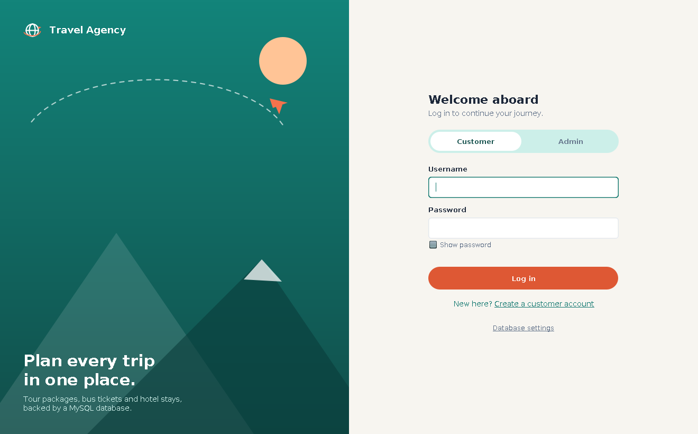
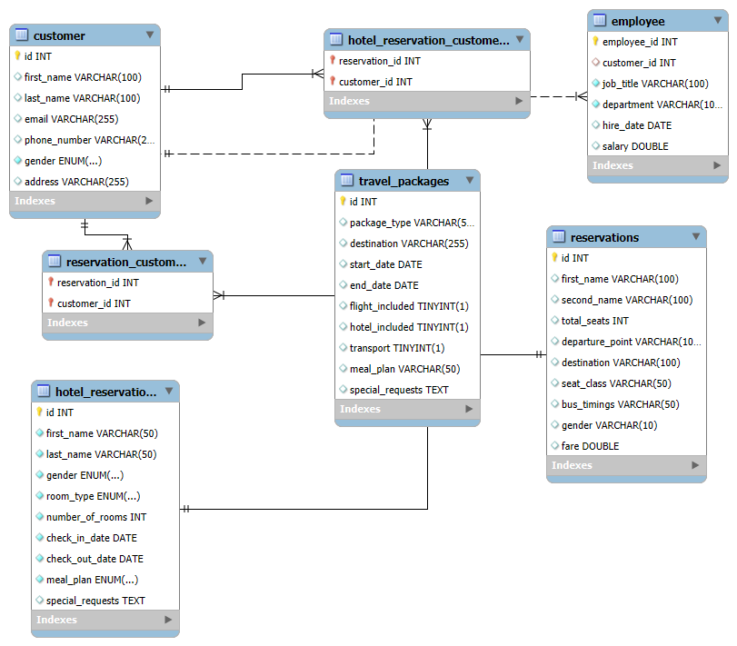
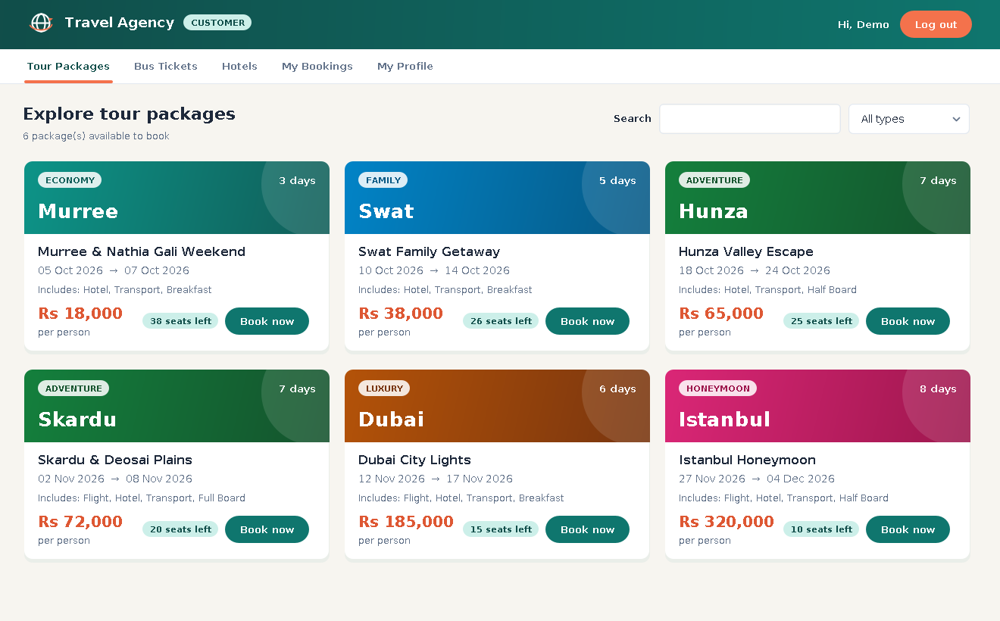
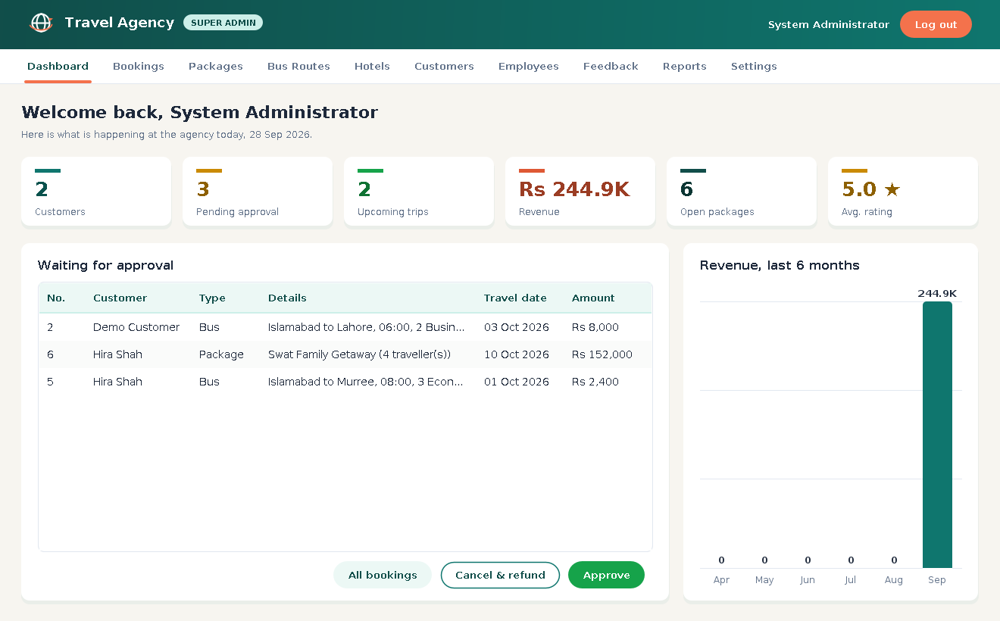
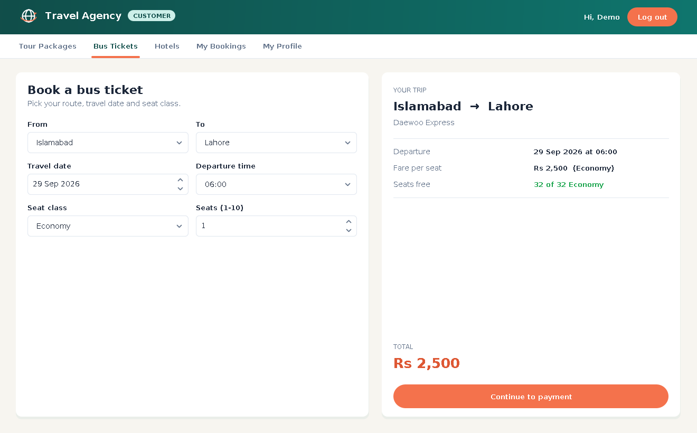
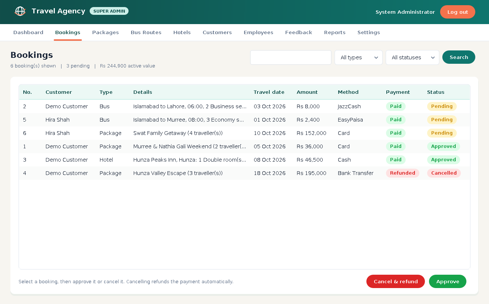
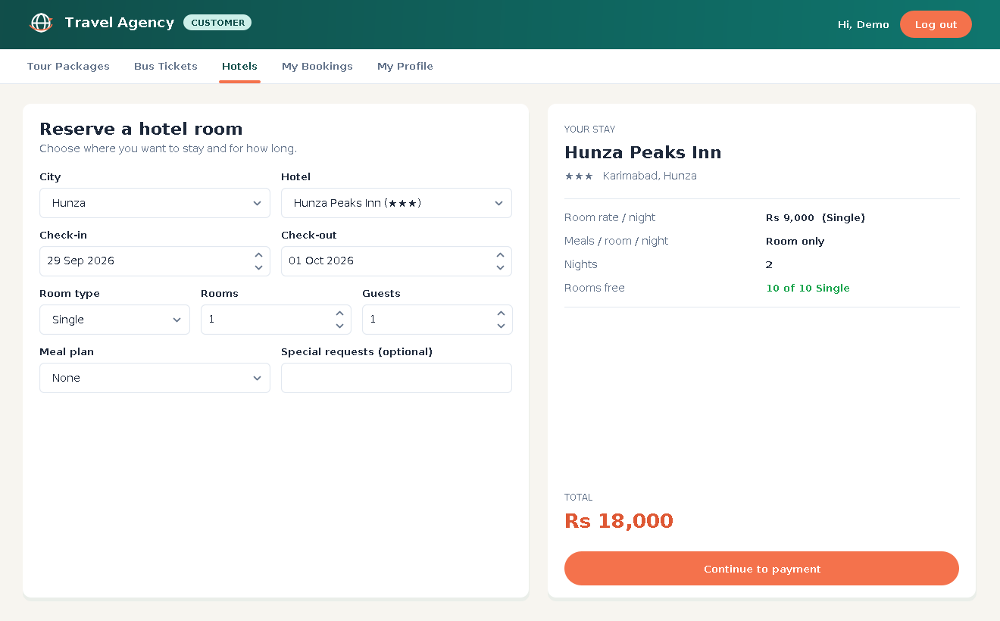
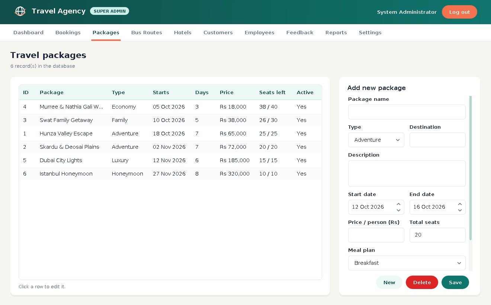
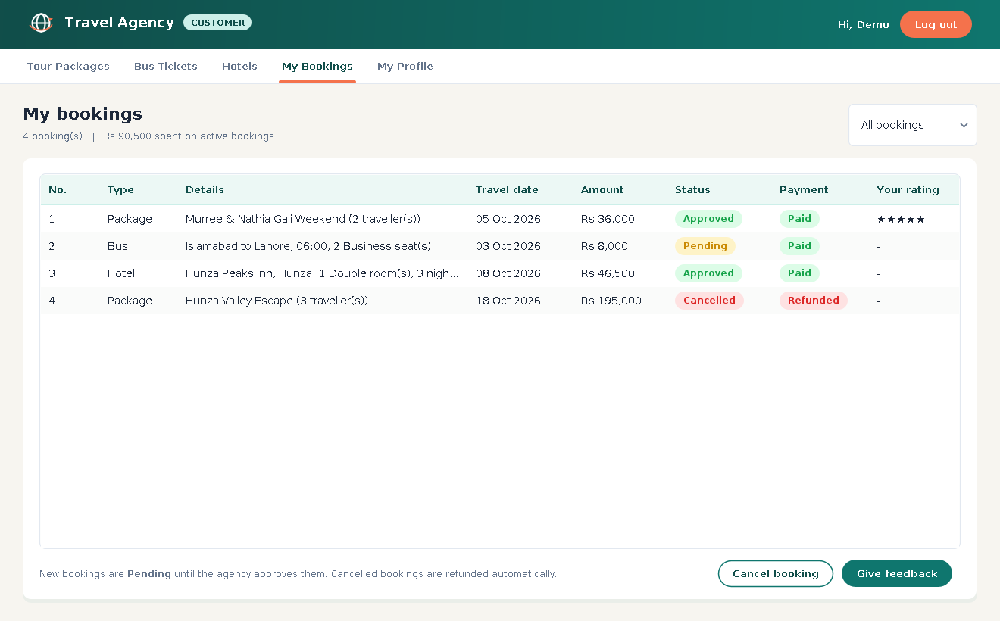
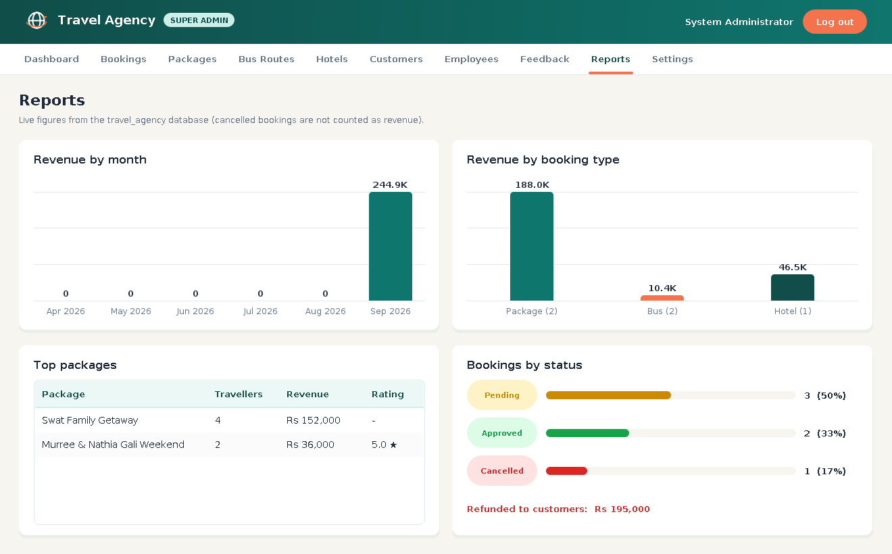

# 🌍 Travel Agency Management System

A desktop travel agency application built with **Java Swing** and a **MySQL** database, made as our Database Systems semester project.

Customers can explore tour packages, book bus tickets and reserve hotel rooms. The agency's admins approve bookings, manage the catalogue, employees and customers, and see live reports. All of it is stored in MySQL through JDBC.



---

## ✨ Features

### Customer portal
- **Sign up / log in** with salted SHA-256 password hashing
- **Tour packages**: card view with search and type filter; seats left are updated live
- **Bus tickets**: pick route, date, departure time, Economy / Business class and number of seats; the fare and free seats update as you choose
- **Hotels**: city, hotel, room type, check-in / check-out, meal plan, guests; the price and free rooms are calculated per night
- **Payment**: Cash, Card, Bank Transfer, JazzCash or EasyPaisa
- **My bookings**: status and payment of every booking, cancel (auto refund), give 1–5 star feedback
- **My profile**: edit details and change password

### Admin portal
- **Dashboard**: customers, pending approvals, upcoming trips, revenue, open packages, average rating and a 6-month revenue chart
- **Bookings**: filter by type, status and search text; approve or cancel & refund
- **Packages / Bus routes / Hotels**: add, edit, deactivate or delete (with safety checks so existing bookings are never broken)
- **Customers**: search, and delete accounts that have no upcoming trips
- **Employees**: full add, edit and delete
- **Feedback**: all reviews with ratings
- **Reports**: revenue by month and by booking type, top packages, bookings by status, total refunded
- **Settings**: change password; the Super Admin can add new admins

### Correctness
- **No overbooking**: seats and rooms are checked inside a transaction with `SELECT ... FOR UPDATE` row locks (tested with 10 parallel bookings for the last 2 seats: exactly 2 succeed)
- Hotel availability is checked **night by night**, so overlapping stays are handled correctly
- A customer cannot cancel on or after the travel day, and only approved bookings can get feedback (one per booking)
- Admins cannot shrink a bus, hotel or package below what is already booked, change the dates of a package that has bookings, or remove a departure time that has bookings
- All input is validated (names, emails, phone numbers, amounts, dates) with clear messages

---

## 🗄️ Database design

Database: `travel_agency` (script: [`src/travelagency/travel_agency.sql`](src/travelagency/travel_agency.sql))

| Table | Purpose |
|---|---|
| `admins`, `customers` | Users (hashed passwords with salt) |
| `employees` | Agency staff |
| `travel_packages`, `bus_routes`, `hotels`, `meal_plans` | Catalogue |
| `bookings` | **Generalization**: common data of every booking (customer, type, date, amount, status) |
| `package_bookings`, `bus_bookings`, `hotel_bookings` | **Specialization**: details for each booking type (1 : 1 with `bookings`) |
| `payments` | One payment per booking |
| `feedback` | One rating per approved booking |

Also used:
- **Primary / foreign keys** with `ON DELETE CASCADE` / `SET NULL`, `UNIQUE` and `CHECK` constraints, and `ENUM`s
- **Trigger** `trg_refund_on_cancel`: marks the payment *Refunded* when a booking is cancelled
- **Stored function** `fn_package_seats_left(package_id)`
- **Views** `v_booking_overview` (one readable line per booking) and `v_revenue_by_type`



---

## 🚀 How to run

### Requirements
- **JDK 17** or newer
- **MySQL 8** (MySQL Server + Workbench, or XAMPP)
- MySQL Connector/J is already included in `lib/`

### 1. Set up the database
**Option A (automatic):** just run the app. If the database is not found, a setup window opens. Enter your MySQL host, port, user and password, then click **Connect & Continue**. The tables and demo data are created for you, and the settings are saved in `database.properties`.

**Option B (MySQL Workbench):** open `src/travelagency/travel_agency.sql`, run the whole script, then start the app and enter your MySQL password in the setup window.

### 2. Open and run the project
- **NetBeans**: *File → Open Project* → select the `TravelAgency` folder → *Run* (F6)
- **VS Code** (with *Extension Pack for Java*): open the folder, then run `TravelAgency.java`
- **Command line**:
  ```bash
  javac -encoding UTF-8 -cp lib/mysql-connector-j-9.1.0.jar -d build/classes src/travelagency/*.java
  cp src/travelagency/travel_agency.sql build/classes/travelagency/
  java -cp "build/classes:lib/mysql-connector-j-9.1.0.jar" travelagency.TravelAgency
  ```
  On Windows, use `;` instead of `:` in the classpath.

### 🔑 Demo logins
| Role | Username | Password |
|---|---|---|
| Admin (Super Admin) | `admin` | `admin123` |
| Customer | `demo` | `demo123` |

New customers can create their own account from the login screen.

---

## 📸 Screenshots

| Customer | Admin |
|---|---|
|  |  |
|  |  |
|  |  |
|  |  |

---

## 📁 Project structure
```
TravelAgency/
├── src/travelagency/
│   ├── TravelAgency.java          # entry point
│   ├── Database.java              # JDBC connection, install script, helpers
│   ├── *Repository.java           # SQL for auth, catalogue, bookings, admin reports
│   ├── Models.java, Validate.java, Security.java
│   ├── LoginFrame, SignupDialog, DatabaseSetupDialog
│   ├── CustomerPortal + PackagesPage, BusPage, HotelPage, MyBookingsPage, ProfilePage
│   ├── AdminPortal + Dashboard, Bookings, Packages, Routes, Hotels, Customers,
│   │   Employees, Feedback, Reports, Settings pages
│   ├── Ui.java                    # theme, colours and custom components
│   └── travel_agency.sql          # schema, trigger, function, views, demo data
├── lib/mysql-connector-j-9.1.0.jar
├── docs/                          # proposal, presentation, EERD
└── nbproject/, build.xml          # NetBeans project
```

---

## 👩‍💻 Team
- **Hafsa Khurram**
- **Zainab Asif**
- **Syeda Humaima**
